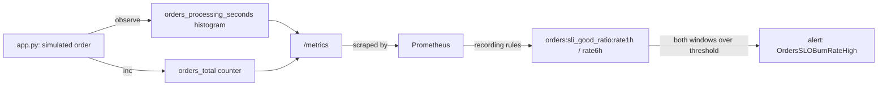

# SLO burn-rate metrics service

A Python service that simulates processing orders, exposes two Prometheus business metrics
(a latency histogram and an outcome counter) on `/metrics`, and ships a multi-window SLO
burn-rate alert following the Google SRE workbook pattern.

**Scope.** `app.py` is a fake order simulator - not a real shop, not real traffic. No
Grafana dashboard, no Alertmanager config, and no endpoint beyond `/metrics`. Never run against
real traffic or a real Prometheus server - see Status below.

## Architecture



## Metrics

- `orders_processing_seconds` - Histogram, label `outcome` (`success`/`failure`). Bucket
  boundaries include `0.5` on purpose - that's the latency threshold
  `config/slo.example.yaml` and `rules/slo-burn.rules.yml` both use.
- `orders_total` - Counter, label `outcome` (`success`/`failure`).

## Prerequisites

- Python 3.12+
- `pip install -r requirements.txt` (`prometheus_client`, `pyyaml`)

## Usage

```bash
pip install -r requirements.txt
python app.py
# in another shell
curl localhost:8000/metrics
```

`METRICS_PORT` overrides the default port (`8000`).

## SLO math (`slo.py`)

Pure functions, no server, no I/O beyond `load_config`:

- `sli(good_count, total_count)` - fraction of orders under the latency threshold. Returns
  `1.0` (fully healthy) with zero orders, rather than dividing by zero.
- `error_budget(target)` - `1 - target`. Raises `ValueError` for `target` outside `(0, 1)` -
  a target of exactly `1.0` has no budget at all and would divide by zero downstream.
- `burn_rate(observed_sli, target)` - observed error rate divided by the error budget. `1.0`
  means burning exactly as fast as the budget sustains; above `1.0` means burning faster.
- `load_config(path)` - loads and validates a `config/slo.example.yaml`-shaped file: `target`
  in `(0, 1)`, `latency_threshold_seconds` positive, `windows` a non-empty list. Raises
  `ValueError` on anything else.

## Config

`config/slo.example.yaml`:

```yaml
target: 0.99
latency_threshold_seconds: 0.5
windows:
  - 1h
  - 6h
```

Placeholders only - no real account IDs or endpoints appear anywhere in this repo.

## Alert rule (`rules/slo-burn.rules.yml`)

Two recording rules (`orders:sli_good_ratio:rate1h`, `...rate6h`) compute the SLI over each
window from the histogram's `le="0.5"` bucket. `OrdersSLOBurnRateHigh` fires only when **both**
windows show the budget burning faster than sustainable - 14.4x over 1h and 6x over 6h, the
standard page-tier multipliers for that window pair against a 2% (30-day) budget. Requiring
both avoids paging on a brief 1h blip that a 6h view shows isn't a real trend, and avoids
reacting too slowly to something that's actually urgent. The `0.01` in the alert expression is
`1 - target` from `config/slo.example.yaml`'s `target: 0.99` - keep it in sync if that target
changes, since Prometheus rules can't read an external YAML file at evaluation time.

## Security considerations

- No secrets, credentials, or real endpoints anywhere - `app.py` only serves its own metrics,
  and nothing in this repo makes an outbound network call.
- `config/slo.example.yaml` and the rule file use only numeric placeholders, never a real
  hostname or account ID.

## Idempotency

`/metrics` is a pure read of the current counter/histogram state - scraping it never changes
anything. Re-running `app.py` starts fresh metrics (no persisted state across restarts), which
is the expected behavior for a Prometheus client library.

## Validation

```bash
pip install -r requirements-test.txt
ruff check .
ruff format --check .
python -m unittest discover -s tests
promtool check rules rules/slo-burn.rules.yml
promtool test rules tests/slo_burn.test.yml
```

- `tests/test_slo.py` - the burn-rate math: under threshold, over threshold, exact target,
  zero orders (no divide-by-zero), a target of `1.0` (rejected, no divide-by-zero), and
  `load_config` rejecting an out-of-range target, a non-positive threshold, empty windows, and a
  non-mapping file - plus confirming the committed example config itself loads cleanly.
- `tests/test_app.py` - `/metrics` output contains the histogram and counter with the expected
  names and the `outcome` label, and that the `0.5` bucket boundary is present.
- `tests/slo_burn.test.yml` (`promtool test rules`) - one case where 99.2% of orders are under
  threshold (never fires) and one where only 80% are (sustained across both windows, fires)
  for `OrdersSLOBurnRateHigh`.

## Status

Never run against real traffic or a real Prometheus server. Validated only with the unit tests
above, `promtool check rules`/`test rules` against a synthetic fixture, and `ruff`. The
recording rules' output has never been checked against anything a live Prometheus actually
scraped and evaluated.

## Known limitations

- One alert, one label pair (`success`/`failure`), one latency threshold - matching the
  problem statement exactly, no extra severities or metrics.
- `app.py`'s simulated latency and failure rate are fixed constants, not configurable from
  `config/slo.example.yaml` - that file only documents the SLO target the rules evaluate
  against, it is not read by `app.py` itself.
